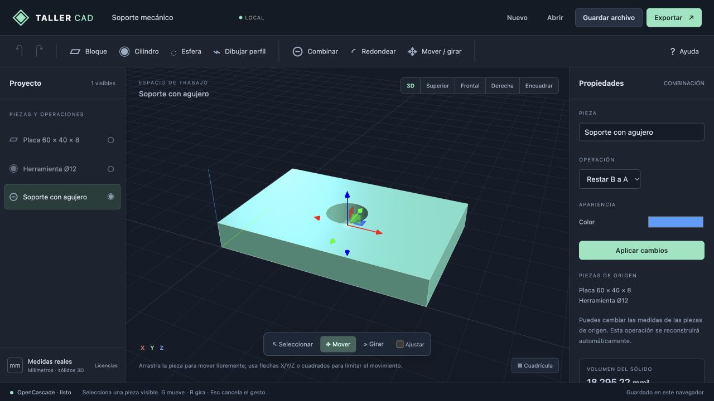
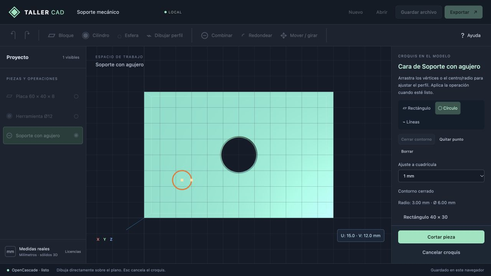

# Taller CAD · Progreso de la entrega

**Estado del documento: provisional y pendiente de revisión con el usuario.**

Este informe describe la entrega de manipulación directa y croquis sobre planos. Las capacidades enumeradas como implementadas corresponden al código; las próximas ideas se recogen aparte y siguen pendientes de acuerdo.

## Resultado disponible

Aplicación publicada: [Taller CAD](https://rubenmena-cursos.netlify.app/cad/).

El editor funciona en el navegador, sin cuenta ni servicio de geometría remoto. Usa la distribución `opencascade.full` de OpenCascade.js en un worker y Three.js para la vista 3D. Esto no equivale a portar FreeCAD ni a exponer toda la API C++ de OCCT.

Continúa dentro de `RubenDarioMena/Courses-RDM`, en `/cad/`. La portada, Arena y los cursos conservan sus rutas. La extracción a otro proyecto todavía no se ha realizado.

## Implementado y comprobado

- Primitivas, booleanas, redondeo, transformaciones, edición numérica y reconstrucción de dependencias.
- Movimiento libre agarrando la superficie, controles por X/Y/Z y planos de traslación, y rotación mediante anillos. G activa mover y R activa girar.
- Previsualización durante el gesto, un único cambio paramétrico al soltar, deshacer/rehacer y cancelación con Esc. Ajustar usa pasos de 1 mm y 15°.
- Selección de planos XY/XZ/YZ y de caras BRep planas para dibujar directamente sobre el modelo.
- Rectángulos, cuadrados manteniendo Mayús, círculos y perfiles cerrados de líneas conectadas. Ajuste a cuadrícula o dibujo libre.
- Arrastre de vértices, centros y radios. Reapertura de perfiles existentes para cambiar su forma y profundidad.
- Extrusión como sólido nuevo, adición a una pieza o corte, con profundidad y sentido de la normal. Los círculos conservan centro/radio y producen geometría exacta en OCCT.
- Guardado local, proyectos JSON portables e intercambio STEP/STL. Un STL conserva su condición de malla.
- Recuperación del último estado válido ante errores geométricos y copia del guardado anterior cuando no puede reconstruirse.
- Licencias, fuentes correspondientes y materiales de reproducción publicados junto al motor.

## Evidencia de la entrega

La [suite de la implementación funcional](https://github.com/RubenDarioMena/Courses-RDM/actions/runs/38689684969), commit `9efde1d`, aprobó 33 recorridos: 11 en Chrome, 11 en Edge y 11 en Firefox sobre Windows. No hubo reintentos. Incluye mover, girar, cancelar, croquis orientados, corte circular sobre una cara, archivos y recuperación.

`npm test` aprobó 39 pruebas: 15 de documento CAD, 12 del núcleo OCCT real, 3 de colocación y 9 de Arena. La compilación del sitio completo pasó en los tres trabajos Windows. Las máquinas de prueba son entornos virtuales de GitHub Actions con renderizado por software; no constituyen una medición de rendimiento en un PC con GPU física.

La revisión manual comprobó arrastre libre y por eje, giro con anillos, rectángulo en XZ, corte circular sobre una cara y cambio del radio por arrastre con reconstrucción del corte dependiente. La revisión pública comprobó que los controles y el croquis están disponibles en Netlify.

El [informe de cierre de la revisión final](https://github.com/RubenDarioMena/Courses-RDM/actions/runs/38725415196), commit `5b532fe`, aprobó de nuevo los 33 recorridos de navegador y las 39 pruebas del proyecto, con compilación completa en Chrome, Edge y Firefox sobre Windows. Incluye los últimos ajustes de cuadrícula y contornos de ancho visible sobre piezas seleccionadas. La versión pública se comprobó visualmente y sin errores de consola.

Capturas de la versión pública, conservadas con este informe:

## Limitaciones conocidas

- Un contorno cerrado por operación. Aún no hay cotas persistentes, restricciones, solver ni perfiles con islas interiores.
- Los apoyos de croquis requieren caras planas BRep; no admiten superficies curvas ni STL.
- La referencia de apoyo usa índice de cara y número de caras. Detecta algunos cambios de topología, pero no resuelve la identificación estable general de caras y aristas.
- El pivote de manipulación está en el centro de la caja envolvente. La selección múltiple no implica manipulación conjunta de varios cuerpos.
- La profundidad de extrusión/corte se ajusta numéricamente; todavía no tiene un tirador 3D de profundidad.
- El redondeo intenta todas las aristas compatibles; no hay selección individual de aristas para esa operación.
- Los límites actuales son 100 operaciones, 1.024 vértices por perfil y 40 MB por proyecto. Faltan pruebas sistemáticas de modelos grandes y memoria.
- El primer acceso descarga el motor WASM completo. No se ha implementado una aplicación instalable ni un modo offline garantizado.
- No hay ensamblajes, planos de fabricación, colaboración ni importación del historial de FreeCAD.

## Continuidad

Antes de ampliar herramientas, revisar con el usuario el alcance y la separación a proyecto propio. Las bases de conversación son [el plan provisional](PLAN_PROVISIONAL.md) y [la propuesta de separación](SEPARACION_PROVISIONAL.md). No interpretar esos borradores como una lista ya autorizada para implementar íntegramente.

La arquitectura, el formato paramétrico, las licencias y los comandos de reproducción están en [CAD_WEB.md](../CAD_WEB.md). Mantener la independencia entre simulación/render de Arena y el editor CAD.
